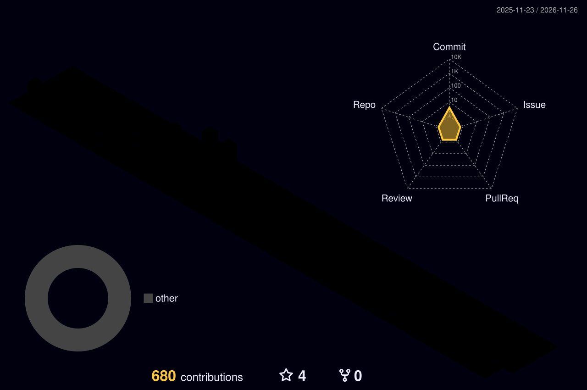

<p align="center">
  
</p>

<p align="center">
  <a href="https://www.youtube.com/@EAugusto">
    
  </a>
</p>

<p align="center">
  <a href="https://www.youtube.com/@EAugusto"></a>
  <a href="https://github.com/eaugusto7?tab=followers"></a>
  
</p>

<br>

<table align="center">
<tr>
<td width="58%" valign="top">

```go
package main

type Desenvolvedor struct {
	Nome       string
	Cargo      string
	Formacao   []string
	Pesquisa   []string
	Linguagens []string
	Hobbies    []string
}

func main() {
	eduardo := Desenvolvedor{
		Nome:  "Eduardo Augusto",
		Cargo: "Analista de TI @ IFSP",
		Formacao: []string{
			"Doutorado em Ciência da Computação @ UFLA",
			"Mestre em Eng. de Sistemas e Automação @ UFLA",
			"Engenheiro de Computação",
		},
		Pesquisa: []string{
			"RT-PPP/INS tightly coupled",
			"EKF 17 estados", "Fixed-lag Factor Graphs",
			"RTK centimétrico em embarcados low-cost",
		},
		Linguagens: []string{"C++", "Python", "Go", "TypeScript", "MATLAB"},
		Hobbies:    []string{"Retro games", "Gamedev", "Lives de GTA VI"},
	}
	_ = eduardo
}
```

</td>
<td width="42%" valign="top">

### 🛰️ Agora
- 📡 Fusão **INS + GNSS** com EKF e **Factor Graphs** rodando em **Raspberry Pi 4**
- 🗺️ **Monitor GNSS** (Go/Gin + Angular 17 + MongoDB + MQTT)
- 🐧 **Sombra OS**, minha distro Linux baseada em Debian
- 🦇 **Réquiem Carmesim**, um survivors gótico para a Steam

### 🏆 Destaques
- 📄 2 publicações **IEEE** (uma no **ITSC 2024**)
- 💾 Software de navegação RT-PPP/INS com **registro no INPI**
- 🎙️ Lives e retro games no YouTube

</td>
</tr>
</table>


<h2 align="center">⚙️ Arsenal</h2>

<p align="center">
  <br>
  <br>
  
</p>


<h2 align="center">🚀 Projetos em destaque</h2>

<table align="center">
<tr>
<td width="50%" valign="top">

#### 🛰️ INS-RT-PPP-GNSS
Navegação RT-PPP/INS fortemente acoplada em C++ no Raspberry Pi 4. Quatro estimadores em paralelo (WLS, EKF, LC, TC), dashboard Flask com mapa Leaflet e streaming SSE, API REST com Swagger.

<sub>`C++` `Eigen` `Python` `Flask` `ARM64`</sub>

</td>
<td width="50%" valign="top">

#### 📡 Monitor GNSS
Monitoramento de receptores e bases GNSS low-cost em parceria VALE/UFLA. Coletores Python via MQTT, backend Go/Gin, frontend Angular 17 e coleta por celulares Android.

<sub>`Go` `Gin` `Angular` `MongoDB` `MQTT`</sub>

</td>
</tr>
<tr>
<td width="50%" valign="top">

#### 🌐 Cliente NTRIP RBMC
Cliente NTRIP em Python com interface web, inspirado no BNC, para receber e gravar correções da RBMC-IP do IBGE.

<sub>`Python` `NTRIP` `RTCM` `GNSS`</sub>

</td>
<td width="50%" valign="top">

#### 🐧 Sombra OS
Distro Linux leve baseada em Debian, com GNOME personalizado, tema dark sci-fi e ambiente de desenvolvimento pronto para C, C++, Go, Java, Node e Angular.

<sub>`Debian` `live-build` `GNOME` `Docker`</sub>

</td>
</tr>
<tr>
<td width="50%" valign="top">

#### 💳 Totem de Pagamentos
Totem de autoatendimento com PIX e cartões, frontend Angular e backend Go.

<sub>`Angular` `Go` `MongoDB` `CI/CD`</sub>

</td>
<td width="50%" valign="top">

#### 🦇 Réquiem Carmesim
Roguelite survivors gótico com sprites renderizados no Blender, visão isométrica e três heróis jogáveis.

<sub>`Unity` `C#` `Blender`</sub>

</td>
</tr>
</table>


<h2 align="center">📊 No GitHub</h2>

<p align="center">
  
</p>

<p align="center">
  
  
</p>

<p align="center">
  
</p>

<p align="center">
  
</p>

<p align="center">
  
</p>


<h2 align="center">🔴 Últimos vídeos no YouTube</h2>

<p align="center">
<!-- YOUTUBE:START --><a href="https://www.youtube.com/shorts/9zM-UABwxlI"></a><a href="https://www.youtube.com/watch?v=DI-e5yK8-tE"></a><a href="https://www.youtube.com/shorts/6ke-vjymUFc"></a><a href="https://www.youtube.com/shorts/OMNGYFIRElo"></a><!-- YOUTUBE:END -->
</p>

<p align="center">
  <a href="https://www.youtube.com/@EAugusto"></a>
</p>


<h2 align="center">🐍 A cobra comendo minhas contribuições</h2>

<p align="center">
  <picture>
    <source media="(prefers-color-scheme: dark)" srcset="https://raw.githubusercontent.com/eaugusto7/eaugusto7/output/github-snake-dark.svg" />
    <source media="(prefers-color-scheme: light)" srcset="https://raw.githubusercontent.com/eaugusto7/eaugusto7/output/github-snake.svg" />
    
  </picture>
</p>

<h3 align="center">💬 Bora conversar sobre</h3>

<p align="center">
  
  
  
  
  
  
</p>

<p align="center">
  
</p>
